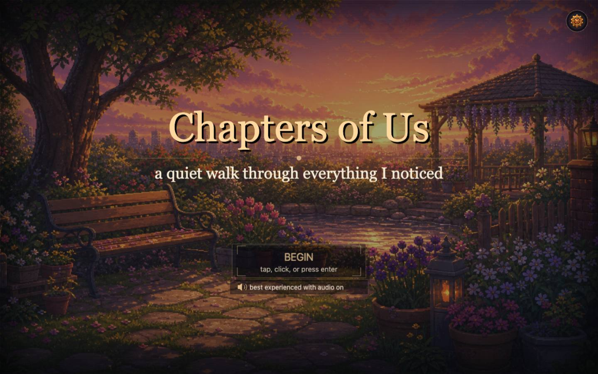
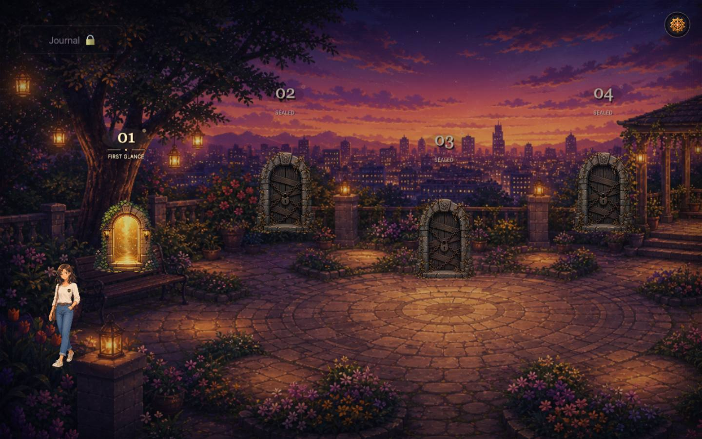
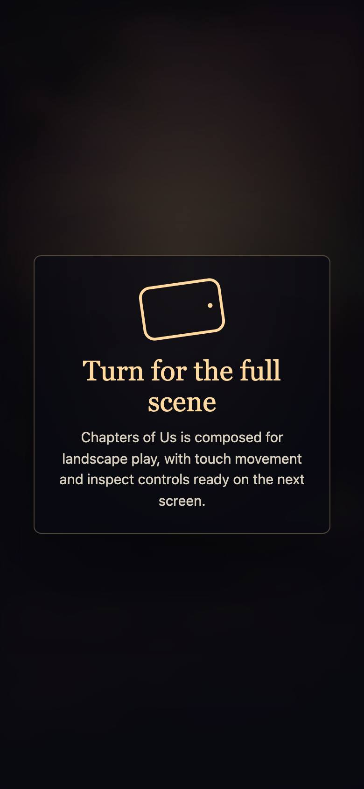

# Chapters of Us

> A narrative 2D RPG built with Phaser 3 and TypeScript — explore small hand-crafted scenes that unlock chapters of a shared story.

**Live:** [north-atlas-3e6f.vercel.app](https://north-atlas-3e6f.vercel.app)

<p align="center">
  
  
  
</p>

## Built with

Phaser 3 · TypeScript · Vite

## Run locally

```bash
npm install
npm run dev
```

## License

Code is released under the [MIT License](LICENSE). Photos, video, artwork, audio and written content are not covered by it: personal media is © Prawal Sharma, all rights reserved, and third-party assets remain under their own licenses.
